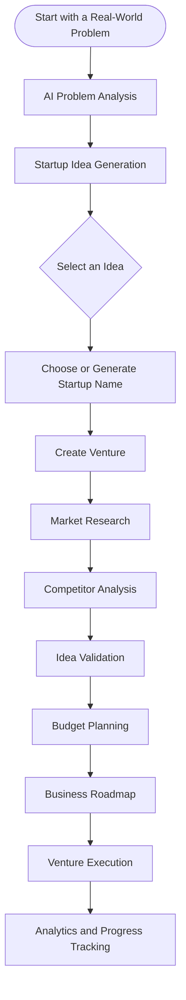
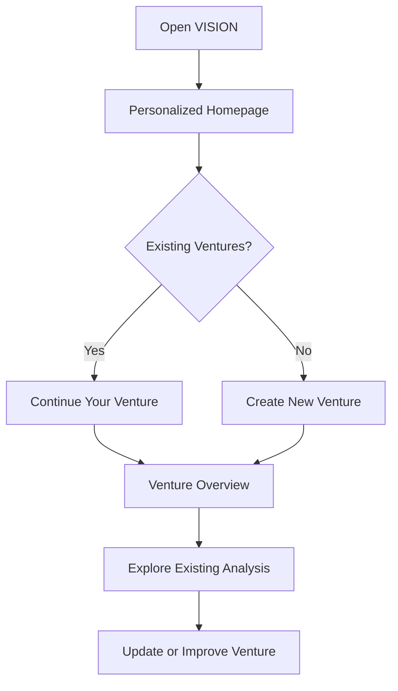
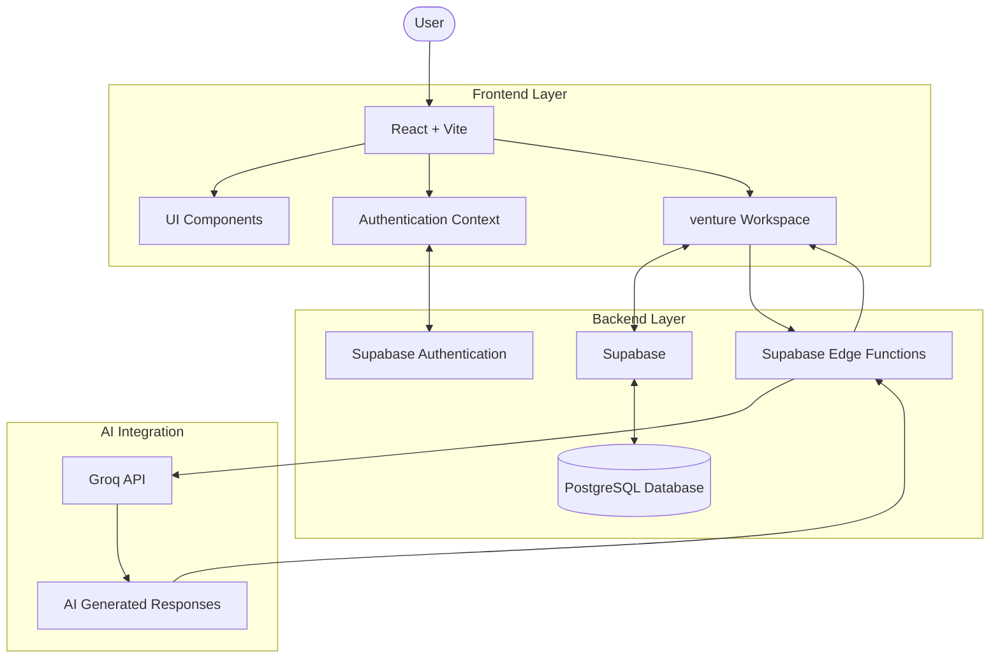
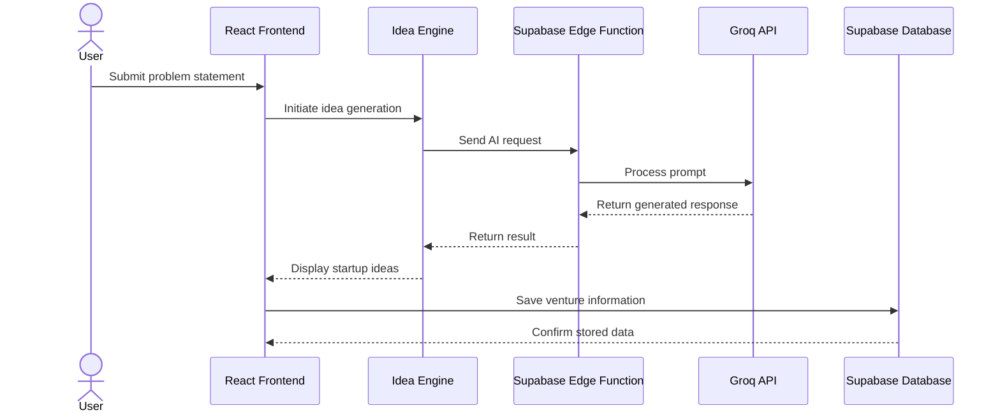

# 🚀 VISION | Problems to Possibilities

### From real-world challenges to startup opportunities — powered by AI.

VISION is an AI-powered venture-building platform that helps aspiring entrepreneurs transform real-world problems into structured startup opportunities.

It brings problem discovery, AI-powered ideation, market research, competitor analysis, idea validation, budget planning, and venture management into one unified workspace.

**Discover once. Build continuously. Improve anytime.**

---

## ✨ What Makes VISION Different?

VISION goes beyond generating startup ideas. It provides a structured environment to explore, evaluate, plan, and manage startup ventures.

### Core Features

| Feature | Description |
|---|---|
| 🧠 AI Problem Discovery | Analyze real-world problems and identify opportunities. |
| 💡 Startup Ideation | Generate and explore AI-powered startup concepts. |
| 🏷️ Startup Identity | Create custom startup names or generate suggestions using AI. |
| 📊 Market Research | Explore target markets and potential opportunities. |
| ⚔️ Competitor Analysis | Examine competitors, positioning, and market gaps. |
| 🎯 Idea Validation | Evaluate feasibility, demand, competition, and scalability. |
| 💰 Budget Advisor | Generate preliminary startup budget estimates in INR. |
| 🗺️ Business Roadmap | Convert startup ideas into actionable execution plans. |
| 📈 Analytics Dashboard | Track venture activities, tasks, and progress visually. |
| 🤝 Collaborations | Invite and connect with other users. |
| 🏢 Venture Management | Save, manage, and continue multiple startup ventures. |
| 👤 Personalized Workspace | Access ventures and information through a personalized experience. |

---

## 🔄 How VISION Works

The platform follows a structured startup development workflow.



### Returning User Workflow

VISION maintains venture information so users can continue working without repeating the discovery process.



---

## 🏗️ System Architecture

VISION uses a React-based frontend connected to Supabase for backend services and AI-powered operations.



### Architecture Overview

**Frontend**
- React.js for component-based UI development.
- Vite for development and production builds.
- JavaScript for application logic.
- CSS for interface styling.
- Lucide React for icons.

**Backend**
- Supabase for database and backend services.
- PostgreSQL for persistent data.
- Supabase Authentication for user accounts.
- Supabase Edge Functions for server-side operations.

**AI Integration**
- Groq API for AI-powered generation and analysis.
- Supabase Edge Functions for handling AI requests.
- AI-assisted problem analysis, ideation, and business planning.

---

## 🧰 Technology Stack

| Technology | Application |
|---|---|
| React.js | Frontend framework |
| Vite | Build tool and development server |
| JavaScript | Application logic |
| CSS | Styling |
| Supabase | Backend and database |
| PostgreSQL | Data storage |
| Supabase Auth | User authentication |
| Supabase Edge Functions | Server-side AI operations |
| Groq API | AI integration |
| Lucide React | Icon library |
| Git & GitHub | Version control |
| Vercel | Application deployment |

---

## 📁 Project Structure

The following is a representative structure showing the major application areas and known implementation files. Refer to the actual repository for the complete file tree.

```text
VISION/
│
├── public/
│
├── src/
│   │
│   ├── components/
│   │   └── landing/
│   │       └── HeroSection.jsx
│   │
│   ├── context/
│   │   └── AuthContext.jsx
│   │
│   ├── App.jsx
│   │
│   ├── ProblemDiscovery.jsx
│   │
│   ├── ideaEngine.js
│   │
│   └── aiChatEngine.js
│
├── supabase/
│   │
│   └── functions/
│       │
│       └── generate-ideas/
│           └── index.ts
│
├── .env                 # Local environment configuration
├── .gitignore
├── package.json
└── README.md
```

### Important Components

| Component / File | Responsibility |
|---|---|
| `App.jsx` | Main application structure and navigation |
| `AuthContext.jsx` | Authentication state management |
| `HeroSection.jsx` | Landing page interface |
| `ProblemDiscovery.jsx` | Problem discovery experience |
| `ideaEngine.js` | Startup idea generation integration |
| `aiChatEngine.js` | AI interaction logic |
| `generate-ideas/index.ts` | Server-side AI generation function |

---

## 🔌 AI Integration Workflow

AI-powered operations are handled through the application's backend integration.



The AI integration supports the platform's problem-solving and venture-development workflows.

---

## ⚙️ Installation & Local Development

### Prerequisites

- Node.js
- npm
- Git
- Supabase account
- Required AI API configuration

### 1. Clone the Repository

```bash
git clone https://github.com/bingisiri07-spec/VISION.git
```

### 2. Navigate to the Project

```bash
cd VISION
```

### 3. Install Dependencies

```bash
npm install
```

### 4. Configure Environment Variables

Create a `.env` file in the project root.

```env
VITE_SUPABASE_URL=your_supabase_project_url
VITE_SUPABASE_PUBLISHABLE_KEY=your_supabase_publishable_key
```

Configure AI credentials separately through Supabase Edge Function secrets.

**Security:** Never commit private API keys, service-role keys, or environment secrets to GitHub.

### 5. Run the Development Server

```bash
npm run dev
```

Open the local development URL provided by Vite.

### 6. Build for Production

```bash
npm run build
```

---

## 🔐 Security & Data Management

VISION uses Supabase to manage user authentication and persistent application data.

Key considerations:

- Authenticated user access.
- Supabase database policies.
- Environment-based configuration.
- Server-side AI credential handling.
- User-specific venture information.

---

## 🎯 Project Goals

- Make early-stage entrepreneurship more accessible.
- Simplify startup exploration and planning.
- Encourage structured problem-solving.
- Bridge the gap between AI-generated ideas and execution.
- Help aspiring founders organize and develop their ventures.

---

## 🔭 Future Scope

VISION is an evolving platform. Potential areas of expansion include:

- Richer market intelligence through external datasets.
- More advanced financial forecasting.
- Improved AI recommendation accuracy.
- Deeper competitor intelligence.
- Advanced venture performance metrics.
- Additional integrations and collaboration capabilities.

---

## ⚠️ Disclaimer

VISION is designed to support early-stage startup exploration and planning. AI-generated recommendations, financial estimates, and market insights are preliminary and should be independently verified before making business or financial decisions.

---

## 👩‍💻 Founder & Developer

**Bingi Siri**  
Artificial Intelligence and Machine Learning Undergraduate | Aspiring AI Product Builder & Entrepreneur

VISION is an independently developed project focused on exploring how Artificial Intelligence can simplify innovation and venture development.

**Recognition:** Bronze Award – Tensor School, Summer of AI Camp.

---

## 📜 License

No open-source license has currently been specified. All rights and permissions remain with the project owner unless a license is added.

---

<div align="center">

### VISION 🚀

**PROBLEMS TO POSSIBILITIES**

*Turning ideas into opportunities. Building possibilities with AI.*

</div>
